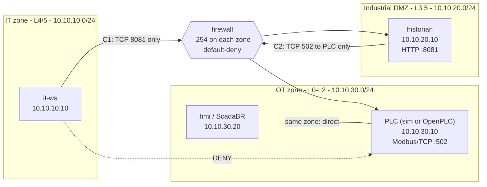

# OT/ICS Network Security Lab: IT/OT Segmentation (Purdue Model)

A reproducible home lab that simulates a small industrial network, segments it into
**IT, DMZ and OT zones** following the **Purdue model**, enforces the design with a
default-deny firewall, and **proves** it with an automated test suite.

> Skills demonstrated: ICS/OT architecture, Purdue model, IEC 62443 zones & conduits,
> Modbus/TCP, firewall policy design, Docker networking, test automation, technical writing.

---

## 1. The problem this solves
Flat industrial networks let any compromised office PC talk straight to PLCs. Most
public OT incidents start in IT and pivot into OT. The fix is **segmentation**:
group assets into zones by function/risk, and allow only documented, minimal
**conduits** between them.

## 2. Architecture



| Purdue level | Lab node | Role |
|--------------|----------|------|
| L4/5 Enterprise | `it-ws` | Office workstation / attacker foothold |
| L3.5 DMZ | `historian` | Read-only data broker (polls PLC, serves HTTP) |
| L2 Supervisory | `hmi` (or **ScadaBR**) | Polls PLC, authorised setpoint writer |
| L1 Control | `plc` (simulator, or **OpenPLC**) | Modbus/TCP server, tank-level logic |
| Boundary | `firewall` | iptables, default-deny, logs denials |

Each node is attached to **one** Docker network only, so the firewall is the sole path
between zones (static routes are added by `node-entrypoint.sh`).

Full design: [`docs/zone-conduit-matrix.md`](docs/zone-conduit-matrix.md) ·
GNS3/VLAN version: [`docs/gns3-topology.md`](docs/gns3-topology.md) ·
Customer-style write-up: [`docs/solution-proposal.md`](docs/solution-proposal.md)

## 3. Quick start

Requirements: Docker + Docker Compose v2, Linux host (or WSL2/Docker Desktop).

```bash
docker compose up -d --build        # builds one shared image, starts 5 containers
./tests/run_tests.sh                # 12 tests -> tests/results/results-<time>.md
./tests/nmap_recon.sh               # attacker's view from the IT zone
docker logs -f firewall             # (or: dmesg | grep FW-DENY on the host) denial logs
docker compose down
```

Handy checks:
```bash
curl http://127.0.0.1:8081                         # historian JSON (published for the lab operator)
docker exec it-ws python3 -c "from pymodbus.client import ModbusTcpClient as C;print(C('10.10.30.10').connect())"   # False -> blocked
docker exec historian python3 -c "from pymodbus.client import ModbusTcpClient as C;c=C('10.10.30.10');c.connect();print(c.read_holding_registers(0,3,slave=1).registers)"
```

## 4. What each test proves

| ID | Test | Expected |
|----|------|----------|
| T01 | IT -> Historian :8081 | ALLOW (conduit C1) |
| T02-T03 | IT -> PLC/HMI :502 | DENY (no direct IT->OT) |
| T04 | IT -> Historian :22 | DENY (only the one port) |
| T05 | Historian -> PLC :502 | ALLOW (conduit C2) |
| T06-T07 | Historian -> PLC :80, HMI :502 | DENY (least privilege) |
| T08 | Historian -> IT | DENY (DMZ is not a pivot) |
| T09-T10 | PLC -> IT / DMZ | DENY (no OT-initiated outbound) |
| T11 | IT user reads data through historian | works end to end |
| T12 | ICMP IT -> PLC | DENY |

Probes are classified OPEN / REFUSED / FILTERED. A "REFUSED" (RST) on a DENY test would be a **FAIL**: it means
the packet reached the host, i.e. the path exists.

## 5. Optional: real OpenPLC and ScadaBR
```bash
# OpenPLC instead of the simulator (needs NAT because OpenPLC can't be given static routes)
PLC_IP=10.10.30.11 NAT_TO_OT=1 docker compose --profile openplc up -d --scale plc=0
# then open the OpenPLC UI, upload plc-program/tank_level.st, compile, start PLC

# ScadaBR (Modbus master at 10.10.30.11:502)
docker compose --profile scadabr up -d
```
> The OpenPLC / ScadaBR image names are community-maintained and can change. Override with
> `OPENPLC_IMAGE=` / `SCADABR_IMAGE=` or build from the official sources. With `NAT_TO_OT=1`
> the PLC sees the firewall's IP instead of the real client, which hurts source-based detection
> (Project 02), a trade-off worth mentioning in interviews.

## 6. Design decisions (and why)
1. **Match on subnets, not interfaces**, because Docker's interface ordering isn't guaranteed.
2. **Default-deny + explicit logged denies** for the paths that must never exist, so the logs are evidence.
3. **Stateful (conntrack)**: only the initiator direction is opened; replies are allowed by state.
4. **Simulator by default**: deterministic, no external image dependency, and generates clean Modbus for Project 02.
5. **Only one published port** (`127.0.0.1:8081`) is for the lab operator and is outside the security model.

## 7. Limitations / next steps
* A port firewall can't separate Modbus reads from writes -> see **Project 02** for detection.
* No authentication/encryption on Modbus/TCP (protocol limitation).
* Add a jump host with MFA for remote access, and an application-aware (DPI) firewall rule for Modbus function codes.
* Map to IEC 62443-3-3 SR 5.1/5.2 in **Project 03**.

## 8. Verification status
* Python components (PLC simulator, HMI, historian) were run and checked end to end in a sandbox.
* Shell scripts passed `bash -n` syntax checks and the compose file parsed as valid YAML.
* The full Docker/iptables lab needs a Docker host with NET_ADMIN; run `./tests/run_tests.sh`
  on your machine and keep the generated report + screenshots as your evidence.

## 9. Repository layout
```
docker-compose.yml     lab topology            firewall/rules.sh   zone policy
tools-image/           shared node image       plc-sim/ hmi/ historian/  node apps
plc-program/           OpenPLC ST program      tests/              verification suite
docs/                  design + proposal       captures/           pcaps for project 02
```
